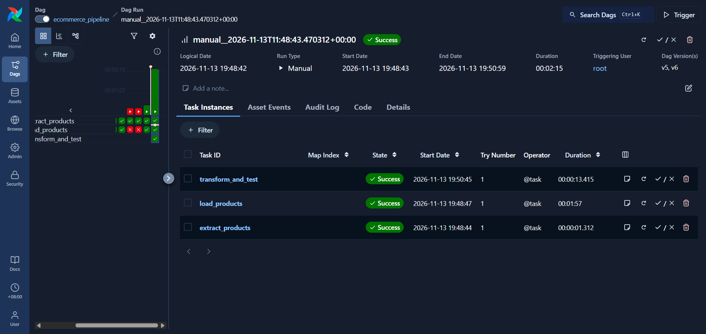

# E-Commerce Data Engineering Pipeline

A data engineering portfolio project that extracts e-commerce product data from a public API, stores raw and normalized data in Amazon S3, and loads structured records into Amazon Redshift Serverless for analytics. Apache Airflow orchestrates the pipeline, while dbt handles data transformations and quality testing.

## Tech Stack

* Python – API ingestion and data preparation
* Amazon S3 – Cloud object storage for raw and prepared data
* Amazon Redshift Serverless – Cloud data warehouse
* SQL – Data loading, validation, and troubleshooting
* dbt Core – SQL-based data transformation, data modeling, and testing
* Apache Airflow (MWAA) – Workflow orchestration

## Pipeline

```text
DummyJSON API
    ↓
Python Extraction and Normalization
    ↓
Amazon S3
    ↓
Amazon Redshift Staging and Validation
    ↓
Incremental MERGE
    ↓
dbt Transformations and Tests
    ↓
Analytics-Ready Data
```

## Data Source

Product data is collected from the public DummyJSON API and used for educational and portfolio purposes.

## Testing

* Successfully executed the end-to-end Airflow pipeline.
* Passed all 18 dbt models and data quality tests.
* Verified idempotent loading to prevent duplicate records.

## Pipeline Execution

The Airflow pipeline successfully completed all tasks.

